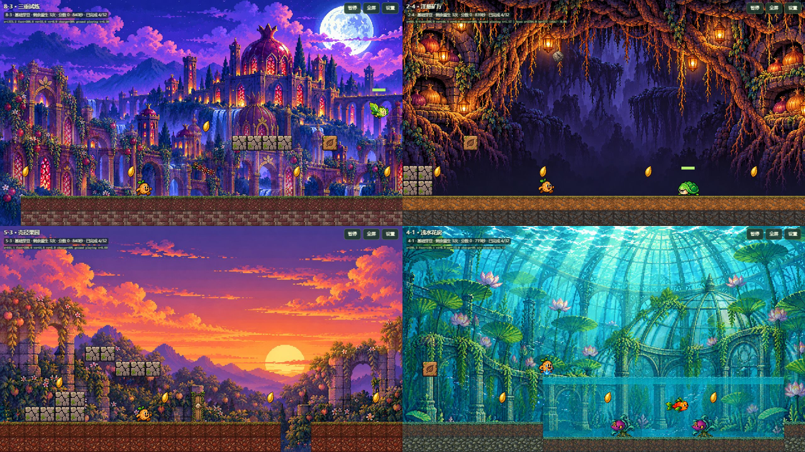

# 实机显示巡检与占位图替换

2026-10-26，仅更新本地。使用 computer-use 操作实际浏览器，结合 imagegen 内置生图生成PNG；没有提交推送或发布外网。

## 实机范围与证据

有记录的抽样游玩覆盖八世界十个小关：1-4、2-4、3-2、4-1、5-1、5-3、6-1、6-2、7-2、8-3，另现场检查了6-3的旋转机关。通过真实键盘输入移动、跳跃、游泳和等待首领进入弱点期，检查尺寸、层级、贴地、透明度和识别度。

使用 `?qa=1&review=placeholder-audit` 的只读巡检入口定位到物件附近，再由正常游戏循环更新。易碎平台另提供站立落脚点，以触发真实的0.8秒倒塌计时。没有关闭敌兵攻击、增加无敌或修改碰撞；热流区和平台接近尝试中实际发生过死亡，因此这些检查不代表通关通过。巡检不会写入正式或调试旅程存档。

检查了854×894的窄窗口和1280×720横屏，结束时恢复了浏览器尺寸。这不是32关完整通关验收，也不是手机硬件验收。结构、资源及碰撞回归覆盖全32关。

现场截图与状态记录：[qa-object-png/review.json](qa-object-png/review.json)，含各场景坐标/状态和截图文件；最后一轮浏览器错误日志为空。

## 发现与修复

| 对象 | 原显示问题 | 当前PNG表现 | 当前地图覆盖 |
| --- | --- | --- | --- |
| 旋转链陷阱 | 三枚橙黄小方块，缺少链身和固定点 | 带刺浆果球、藤木链节、叶片铜铆钉；按原轨道旋转 | 4组机关，6-3与8-3 |
| 落石 | 下落实体为棕色矩形，预警为横条与感叹号 | 有棱面、裂纹和苔点的石块；复用PNG落点环 | 3个落石发射点，2-4与7-2 |
| 壳机关门 | 拉伸世界泥土图并叠“壳”字，难以认出是门 | 藤框木门、明显贝壳徽章与锁闩 | 5-3两扇门 |
| 水域 | 半透明纯色矩形与两像素白线 | 半透明循环水体、气泡和水面波纹 | 27处水域 |
| 平台支撑 | 平台底色与绿色细直条支撑 | 木藤支架、开裂支架和卷藤托架 | 36升降台、9易碎台、24战台 |
| 投射物备用显示 | 动画不可用时退回橙/红矩形 | 从现有正式FX图集裁出籽弹、波、爆裂、火弹PNG | 全关卡备用绘制路径 |
| 云上投手预警 | 黄色横条与向下字符 | 复用PNG落点环 | 云敌兵的预警状态 |

此外，横屏实机发现背景循环边缘硬切。改为按源图比例单图覆盖、5%外扩并限制视差位移，不重复或镜像背景；保持一个月亮及原场景结构，消除循环接缝。地图、敌兵、机关伤害、判定范围和行动规则未修改。

保留血条、首领弱点判定线和轨迹点等必要提示。它们具有明确的界面/瞄准用途，不再承担物件形象的替代绘制。

## 素材分类与生成提示词

五组内置 image_gen 原图及完整提示词分别保存在：

- `art-source/veggie-adventure/objects/object-polish-v1/chain/{generated.png,prompt.txt}`
- `art-source/veggie-adventure/objects/object-polish-v1/rock/{generated.png,prompt.txt}`
- `art-source/veggie-adventure/objects/object-polish-v1/gate/{generated.png,prompt.txt}`
- `art-source/veggie-adventure/objects/object-polish-v1/water/{generated.png,prompt.txt}`
- `art-source/veggie-adventure/objects/object-polish-v1/support/{generated.png,prompt.txt}`

运行PNG集中在 `public/games/veggie-adventure/assets/objects/object-polish-v1/`：10张新生图素材、4张由已有正式FX源图裁切的备用素材。原图/提示词不混入运行素材目录。裁切、来源与哈希在源目录 `build-report.json`。

构建命令：`node tools/veggie-adventure/build-object-polish.cjs`。构建采用alpha裁切与最近邻缩放；水域从生成图的有效内部区域提取，避开外框与杂点。再次构建会重置视觉检查标记，需要重新巡检。本次14张PNG已完成资产图检查与对应场景抽样，并在manifest记录视觉检查来源。

## 验证

236/236自动回归通过；本地HTTP的主模块、渲染器、巡检模块、manifest和14张PNG共18文件与工作区字节一致。

新增检查包括：所有物件及投射物备用路径必须绘制PNG；旋转球始终对准原伤害形状；三形态仍受落石和转链实际接触伤害；全部95巡检点在三种体型下有安全落脚处；14张素材有效像素/透明通道；八世界背景在窄屏、常规横屏和宽屏，以及不同关卡位置保持单图等比例覆盖。

自动证据：`.publish/object-polish-final-tests.txt`、`.publish/object-polish-live-check.json`。实机证据与完整截图保存在 `qa-object-png/`，其中易碎平台站立触发为 `after-crumble-contact.png`，第一世界弱点期为 `after-world1-weak.png`。
