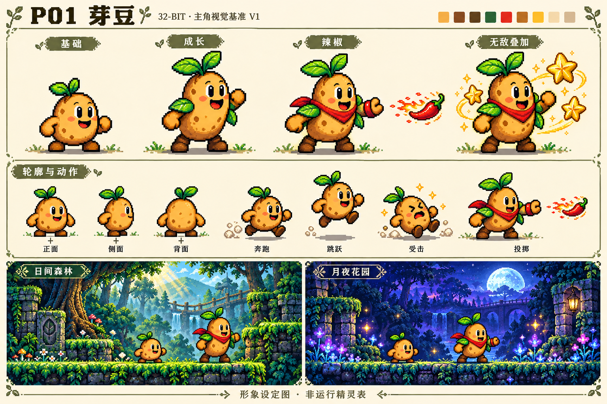

# P01 芽豆 · 视觉基准 V1

## 当前素材交付：透明版 V2

用户要求角色设计卡不带背景，以便后续调用。现已生成 [透明PNG总览](../../art-source/veggie-adventure/concepts/p01-transparent-v2.png)，移除纸底、文字、边框、地面及昼夜场景，保留形态与动作。旧V1仅作历史视觉参考。

PNG为1536×1024，真实Alpha通道；1,101,255像素全透明，约70.02%，四角全透明。角色主体高Alpha，最大254；存在半透明边缘与特效。尚未制作单动作切图、统一网格或动画帧。

[V2提示词](../../art-source/veggie-adventure/prompts/p01-transparent-v2.txt) · [Alpha检查记录](../../art-source/veggie-adventure/concepts/p01-transparent-v2.json)

日期：2026-10-24。使用内置image_gen生成；在用户已授权的自主设计范围内选定本轮基准，不代表用户已进行最终视觉验收。

## 固定识别特征

- 头与躯干为一体土豆，双绿叶芽、土黄色皮肤、深棕短靴。
- 深棕轮廓、清楚的黑色眼睛与高光、克制的腮红和土豆斑点。
- 基础形态圆短；成长后增高，增加叶片护肩。
- 辣椒形态保留成长身体，增加红围巾和投射手腕装饰。
- 无敌是星芒、金色边缘与杨桃环绕的叠加效果；本卡演示叠加在辣椒形态上。
- 正常形态没有背包、帽子、背带裤或白手套。

## 昼夜表现

日间采用03的森林、苔藓石台与景深；夜间采用05的蓝紫与发光植物。
角色使用01的强轮廓思路，提升为32-bit时代精细二维像素风。
本卡中土黄角色与蓝绿背景分离清楚，夜间没有用大面积光晕遮盖角色。
场景示意中的放置尺寸不作为最终实机像素尺寸或碰撞验收依据。

## 正式素材必须校准的项目

- 基础48×48，成长和辣椒48×96；脚底中心锚点一致。
- 对应12×14和12×28逻辑碰撞框，三倍绘制；本卡中的体型差异未严格达到这个比例。
- 固定眼睛、靴子、斑点和两片叶子的拓扑，避免逐帧漂移。
- 精细像素簇、纹理和边缘需要在最终小尺寸下复核，不直接裁切概念图充当精灵。
- 受击采用表情、姿态与短暂闪光，无敌采用杨桃标志，避免两个状态混淆。

## 已查看与未验证

已查看：四种表现、三视图、主要动作、昼夜背景对比、中文标签和整体画面。
未验证：透明通道、精确网格、动作帧连续性、实际游戏尺寸、运行性能、碰撞与战斗。
本轮仅建立视觉基准，运行资产manifest保持空数组。

## 来源

- [完整提示词](../../art-source/veggie-adventure/prompts/p01-visual-baseline-v1.txt)
- [原图](../../art-source/veggie-adventure/originals/p01-design-card-v1.png)
- [生成与检查记录](../../art-source/veggie-adventure/concepts/p01-visual-baseline-v1.json)
