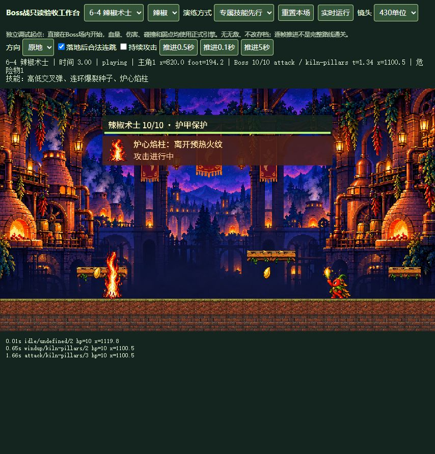
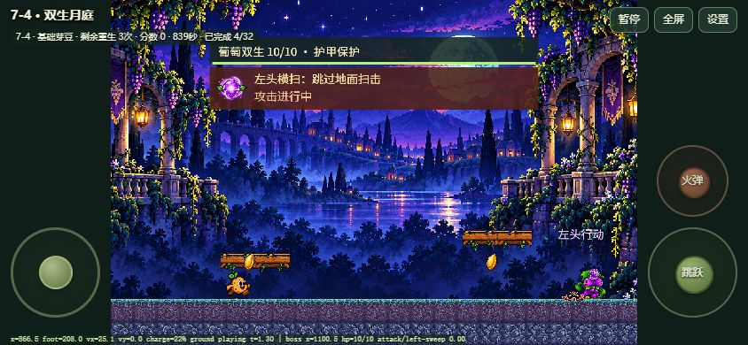

# 后续七大 Boss 战巡检与整改报告

日期：2026-10-27。范围：2-4 至 8-4。已按“清单 → 七场初查 → 集中归因 → 统一修改 → 回归与视觉回查”的顺序完成本轮工作；仅本地更新。

[检查清单](CHECKLIST.md) · [修改前问题总结](FINDINGS.md) · [生成图集总览](effects-contact-sheet.png) · [源图与完整提示词](../../../../art-source/veggie-adventure/effects/boss-signatures-v1/README.md)

## 发现与修复

| 问题 | 本轮处理 | 验证 |
|---|---|---|
| Q01 技能图标和普通弹体重复 | 七套专属效果、七张预警图；原有攻击也使用对应食材图形。矿主落石使用岩石图，榴莲落刺使用刺果图 | 七场预警和攻击截图、透明通道与解码测试 |
| Q02 上方单向平台截断 Boss 弹道 | Boss 弹体穿过单向战台，仍被实体地面阻挡；普通敌兵逻辑保留 | 真实运动回归测试 |
| Q03 矿主与堡主基本相同 | 根脉依次破土，与两枚弹跳刺果区分空间压力 | 两场攻击及弱点回查 |
| Q04 葡萄左右头换名不换招 | 增加两侧低高错层夹击；原横扫朝主角释放；头部说明跟随本体 | 7-4 两类攻击截图、移动方向断言 |
| Q05 莲藕王身体陷入岸地 | 待机和回场脚底对齐地面，保留 70% 水生移动速度 | 4-4 正式画面、待机/恢复运动测试 |
| Q06 战台过薄难辨识 | 复用已生图的木梁藤蔓平台，顶面叠加世界地形条，碰撞高度保留 | 七场正式界面截图 |
| Q07 专属技能可能被距离偏好饿死 | 每第三轮优先专属技能；独立冷却不足则选可用招式 | 普通/低血各 90 秒自动轮换测试 |
| Q08 窄镜头另一端来弹不可见 | 镜头边缘显示对应主题 PNG 与朝向箭头；镜外 Boss 蓄力图标也保留边缘提示 | 256 单位镜头实图与绘制测试 |
| Q09 手机调试文字压住 Boss 名称 | 调试读数移到画面底部；普通游戏布局保留 | 844×390 修改前后对照 |
| Q10 穗枪在近墙时可能提前出界 | 到边缘即抬高折返，到达发射位置后回收；显示尺寸略增 | 回程截图、边缘转向及回收测试 |

## 七种专属技能

| Boss | 新招 | 实际机制 | 独立冷却 | 改后证据 |
|---|---|---|---|---|
| 洋葱矿主 | 根脉破土 | 3 簇定点根晶错时出现，横移或登台避让 | 9秒 | [攻击](after/2-4-signature-attack.png) / [破绽](after/2-4-signature-weak.png) |
| 玉米骑士 | 回旋穗枪 | 低位去程、高位返程，到边缘提前回转 | 9秒 | [回程](after/3-4-effect-active-final.png) / [破绽](after/3-4-signature-weak.png) |
| 莲藕潜王 | 藕孔涌泉 | 两处错时水柱，水花标记先于伤害 | 9.5秒 | [水柱](after/4-4-effect-active-final.png) / [破绽](after/4-4-signature-weak.png) |
| 榴莲堡主 | 弹跳刺果 | 两枚不同速度的低弹刺果，最多弹跳三次 | 9秒 | [攻击](after/5-4-signature-attack.png) / [破绽](after/5-4-signature-weak.png) |
| 辣椒术士 | 炉心焰柱 | 两处火纹预热后错时起火，保留移动空区 | 9.5秒 | [火柱](after/6-4-effect-active-final.png) / [破绽](after/6-4-signature-weak.png) |
| 葡萄双生 | 双生夹击 | 左低珠、右高珠相向飞行，右侧延迟释放 | 10秒 | [夹击](after/7-4-signature-attack.png) / [镜外提示](after/7-4-offscreen-warning-final.png) |
| 石榴王 | 王冠裂籽 | 无伤害核心悬停蓄能，裂出四枚籽晶，地面留隙 | 10秒 | [裂籽](after/8-4-split-shards.png) / [破绽](after/8-4-signature-weak.png) |

全部专属技能前摇为 1 秒；定点伤害还有独立的地面准备时间。专属危险物在这一轮结束时清理，再开放按距离计算的弱点时间。血量保持 7/8/8/9/10/10/12；只在弱点期扣血，受击进入恢复。

## 检查覆盖与证据边界

| 清单 | 本轮证据 |
|---|---|
| B01/02/04/05/06 | 七场修改前后实际 Canvas 截图；七套生图原图、28个效果帧和7张预警PNG；平台、角色朝向与落脚回查 |
| B03/07/08 | UI 分步观察首轮/第二轮与专属招式；普通及狂暴 90 秒真实引擎轮换、频率、冷却、边界测试 |
| B09/10/11/12 | 七种新招均在浏览器中收束到弱点；21组三形态运动落踩测试、护甲/火球/弱点/恢复检查；三形态碰撞仍12×14 |
| B13 | 初查实际发生受伤、死亡及小关起点重生；击败、重生耗尽、自动下一关等沿用既有运行回归。本轮没有逐场完整视觉走完胜利/结局流程 |
| B14 | 七场正式游戏界面分别以 844×390 横屏、触控布局显示，控件位于独立侧栏；256单位窄镜头显示来弹提醒。不是手机硬件触控手感验收 |
| B15 | 280/280 自动回归通过，包含所有PNG解码与HTTP引用；工作台浏览器错误日志为空 |

初查从独立竞技场起点开始，普通伤害、碰撞、重生规则生效；改后专属技能演练仅把起始轮次设为第三轮，不设无敌、不改正式存档、不直接胜利。正式游戏界面也通过可见巡检菜单进入七场，使用键盘移动并保存桌面和横屏截图。自动长时测试使用星状态隔离主角死亡，以验证轮换，不能当成无伤通关记录。

**没有宣称七位 Boss 全部无辅助击败，也没有宣称从七个小关入口完整通关。** 难度和长期手感仍需完整对战反馈；本轮已完成战斗阶段、技能差异、显示问题及对应运行回归检查。

原始日志：[初查](before/observations.json)、[改后演练](after/observations.json)、[正式界面](after/main-interface-observations.json)。最终测试报告：[TEST_RESULTS.txt](TEST_RESULTS.txt)。本轮没有提交、推送或外网发布；原定06:00的32关全面检查任务保持独立，不标记为完成。

## 代表性实际画面

